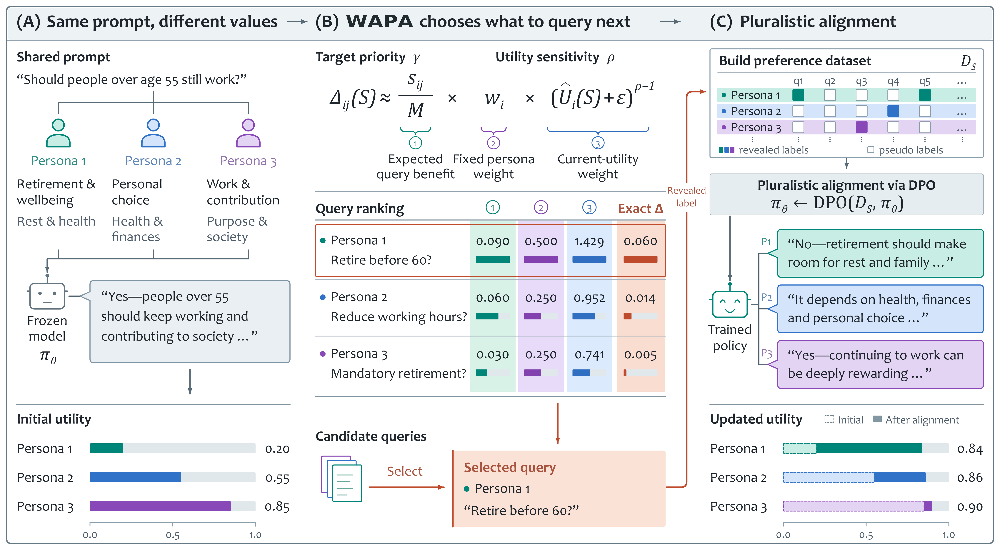

# Welfare-Aware Preference Acquisition for Pluralistic Alignment

[](assets/framework.pdf)

This repository contains code for the paper [Who Should We Listen to More? Welfare-Aware Preference Acquisition for Pluralistic Alignment](https://arxiv.org/abs/TODO_ARXIV_ID) by Ruomeng Ding\*, Tianwei Gao\*, Lianrui Geng, Mohit Bansal, and Zhun Deng.

Pluralistic alignment must accommodate diverse preferences under limited human feedback. AI-generated preference labels reduce annotation costs, but uneven prediction accuracy can leave some individuals poorly represented in training. We introduce **Welfare-Aware Preference Acquisition (WAPA)**, which allocates human feedback through a social welfare objective that accounts for expected supervision improvements, individuals’ current supervision quality, and application-designated priorities. WAPA uses auxiliary reference models to estimate query gains and individual utilities, then selects queries by their estimated marginal welfare gain. Experiments on Roleplay and OpinionQA demonstrate improved supervision and controllable allocation tradeoffs, with downstream policy training improving preference prediction for both seen and unseen individuals.

## Setup

```bash
git clone https://github.com/ZDCSlab/Welfare-Aware-Preference-Acquisition.git
cd Welfare-Aware-Preference-Acquisition
python -m venv .venv                 # Python 3.11 or newer
source .venv/bin/activate
python -m pip install -e '.[download,api,inference]'
```

For acquisition from existing probability files, `python -m pip install -e .` is sufficient. Run commands below from the repository root.

Download the base model [Qwen3-4B-Instruct-2507](https://huggingface.co/Qwen/Qwen3-4B-Instruct-2507):

```bash
python -c "from huggingface_hub import snapshot_download; snapshot_download('Qwen/Qwen3-4B-Instruct-2507', local_dir='models/Qwen3-4B-Instruct-2507')"
```

The collection, training, policy-scoring and generation configs use this model path. Update their `model_path` / `base_model` fields together if you store it elsewhere.

Copy `.env.example` to `.env`, fill in your API keys, and load them into your terminal:

```bash
cp .env.example .env
# Edit .env: fill in DASHSCOPE_API_KEY and DEEPSEEK_API_KEY.
set -a
source .env
set +a
```

## Datasets

| Dataset | Source | Supported stages |
|---|---|---|
| Roleplay | [Public response pairs](https://huggingface.co/datasets/sher222/persona-iterative-responses) | Acquisition, soft DPO, evaluation and generation |
| OpinionQA | [Public processed CSV and codebook](https://github.com/ZDCSlab/Group-Adaptive-Elicitation/tree/643d40f4ad71ee01b8023417e2d8396eab105f54/dataset/opinionqa) | Acquisition and evaluation |

```bash
python scripts/prepare_roleplay.py --download \
  --group north_america --output data/processed/roleplay/north_america
python scripts/prepare_opinionqa.py --config configs/dataset/opinionqa.yaml
```

Roleplay also supports `africa`, `asia`, `europe`, `south_america`, and `heterogeneous`. OpinionQA prepares `midwest`, `northeast`, `south`, and `west`, using the upstream CSV with its existing missing-answer imputation.

Each collection has `acquisition/inputs.parquet` and `labels/acquisition.parquet`. Roleplay additionally has `test_seen_personas/`, `test_heldout_personas/` and their labels. See [data formats](docs/data.md).

## Labelling

The examples use the three reference models from the paper:

| Model | API model ID | Configuration | Key |
|---|---|---|---|
| Qwen3.8-Max | `qwen3.8-max` | `configs/collect_qwen.yaml` | `DASHSCOPE_API_KEY` |
| GLM-5.2 | `glm-5.2` | `configs/collect_glm.yaml` | `DASHSCOPE_API_KEY` |
| DeepSeek-V4-Flash | `deepseek-v4-flash` | `configs/collect_deepseek.yaml` | `DEEPSEEK_API_KEY` |

Qwen and GLM use DashScope Chat Completions; DeepSeek uses its Responses endpoint. The configurations use the paper's model IDs and request settings. Edit these files to use other models or endpoints.

```bash
wapa collect --config configs/collect_target.yaml
wapa collect --config configs/collect_qwen.yaml
wapa collect --config configs/collect_glm.yaml
wapa collect --config configs/collect_deepseek.yaml
wapa aggregate --config configs/aggregate.yaml
```

This produces `outputs/evidence.parquet`. Roleplay probabilities are averaged over both response orders; OpinionQA uses one presentation in source option order. Existing successful calls are reused on rerun.

## Acquisition

The following example uses a **20% query budget**, a fixed random **10% Target group**, and **(gamma, rho) = (2, -5)**:

```bash
python scripts/select_target.py --evidence outputs/evidence.parquet \
  --output outputs/target.json
python scripts/prepare_acquisition.py --config configs/studies/roleplay_joint.yaml

wapa acquire --config outputs/roleplay/north_america/joint/configs/acquire_wapa.yaml
wapa evaluate --config outputs/roleplay/north_america/joint/configs/evaluate_wapa.yaml
wapa preferences --config outputs/roleplay/north_america/joint/configs/preferences_wapa.yaml
```

`prepare_acquisition.py` resolves the budget to `floor(0.2 × number of comparisons)` and inserts the same Target IDs into all methods' configs. It reads evidence and Target IDs to prepare the configs. Evaluation and preference construction subsequently load the labels.

Generated configs also cover `random`, `entropy`, and `reference_disagreement`; replace the `wapa` suffix in the three commands to run a baseline. Entropy and Reference Disagreement use matched welfare weights. Use `configs/studies/roleplay_mean.yaml` for `(gamma, rho) = (1, 1)` with the same Target group.

In the study YAML, `gamma` sets Target priority, `rho` controls sensitivity to low supervision utility, and `epsilon` is the positive shift. See [method details](docs/method.md).

Reference conditions use these generated configs:

| Condition | Command | Config filename under the study's `configs/` directory |
|---|---|---|
| No queries | `wapa evaluate` | `evaluate_no_queries.yaml` |
| Welfare-optimal Oracle | `wapa oracle`, then `wapa evaluate` | `oracle.yaml`, then `evaluate_oracle.yaml` |
| All pseudo-labels | `wapa preferences` | `preferences_all_pseudo_labels.yaml` |
| All ground-truth labels | `wapa preferences` | `preferences_all_ground_truth_labels.yaml` |

### OpinionQA example

The supplied configs use the West region:

```bash
wapa collect --config configs/opinionqa/collect_target.yaml
wapa collect --config configs/opinionqa/collect_qwen.yaml
wapa collect --config configs/opinionqa/collect_glm.yaml
wapa collect --config configs/opinionqa/collect_deepseek.yaml
wapa aggregate --config configs/opinionqa/aggregate.yaml
python scripts/select_target.py --evidence outputs/opinionqa/west/evidence.parquet \
  --output outputs/opinionqa/west/target.json
python scripts/prepare_acquisition.py --config configs/studies/opinionqa_joint.yaml
wapa acquire --config outputs/opinionqa/west/joint/configs/acquire_wapa.yaml
wapa evaluate --config outputs/opinionqa/west/joint/configs/evaluate_wapa.yaml
```

Use `opinionqa_mean.yaml` for equal-weight mean welfare. For another region, change `west` in the input/output paths of the OpinionQA collection, aggregation and study configs. The OpinionQA workflow ends at acquisition evaluation.

## Soft DPO

The preference builder retains all comparisons: selected examples use revealed labels, and the others use base-model soft probabilities. Training uses LlamaFactory with the included soft-label patch:

```bash
python scripts/setup_llamafactory.py --directory ../LlamaFactory-wapa
python -m pip install -e ../LlamaFactory-wapa
wapa train-prepare --config configs/soft_dpo.yaml
wapa train --config configs/soft_dpo.yaml
```

`configs/soft_dpo.yaml` points to the WAPA preference dataset from the joint-welfare example above. For a baseline or reference condition, change `dataset_dir`, `checkpoint_output` and `output`. Adjust batch size and precision for your GPU. `train-prepare` writes the resolved training configuration; `train` launches training. See [soft DPO details](docs/soft_dpo.md).

## Evaluation and Free Responses

```bash
wapa score-policy --config configs/score_policy.yaml
wapa evaluate --config configs/evaluate_policy.yaml
wapa generate --config configs/generation.yaml
```

Set `adapter_path` to your trained adapter, and match scoring `beta` to training `pref_beta`. The examples evaluate seen personas; use `test_heldout_personas` input and label paths for unseen personas. For Target metrics, specify a fixed cohort of persona IDs from the evaluated split.

Evaluation reports Brier utility as **Mean**, bottom-10% **Tail**, and **Target**, plus accuracy. Free-response generation saves model responses for each persona–prompt pair.

## Outputs

| Stage | Main output | Used by |
|---|---|---|
| Labelling + aggregation | `outputs/evidence.parquet` | Acquisition and preference construction |
| Acquisition | `<study>/<method>/selection.json` | Acquisition evaluation and preference construction |
| Preference construction | `<study>/<method>/preferences/` | Soft DPO |
| Training | `checkpoints/wapa/` | Policy scoring and free-response generation |
| Policy scoring | `outputs/evaluation/wapa_probabilities.parquet` | Policy evaluation |
| Evaluation / generation | `outputs/metrics/`, `outputs/generation/` | Result analysis |

Use distinct output paths for each dataset, method and setting. Additional details: [data formats](docs/data.md), [method](docs/method.md), [soft DPO](docs/soft_dpo.md), [runtime notes](docs/runtime.md).

## Citation

```bibtex
@article{ding2026should,
  title={Who Should We Listen to More? Welfare-Aware Preference Acquisition for Pluralistic Alignment},
  author={Ding, Ruomeng and Gao, Tianwei and Geng, Lianrui and Bansal, Mohit and Deng, Zhun},
  journal={arXiv preprint arXiv:2610.19035},
  year={2026}
}
```

## License

WAPA code is released under the [MIT License](LICENSE), copyright (c) 2026 WAPA authors.
